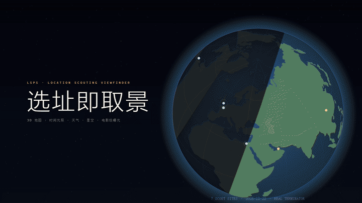

# LSPS · 3D 取景器

Web 版 **3D 选址/取景软件**：联网高精度 3D 地图上模拟任意时刻的光照、天气与星空，
并用电影级相机参数（焦段/画幅/光圈/ISO/快门角/ND）预演"这里这个时间会拍到什么"。

> 对标 CineTracer / SCOUT 一类取景器工具的开源实现。仓库本身 MIT；
> GPL/AGPL 组件全部以进程边界/公开 API 隔离，CI 有许可证白名单闸门。

## 演示



7 个世界地标 × 7 种天气 × 从黄金时刻到深夜。**画面里每个数字都是真的**：太阳高度/方位来自
astronomy-engine，照度与 Bortle/SQM 来自 `@lsps/core` 曝光模型，焦段直接驱动 Cesium 相机视场角，
曝光 Δ 驱动画面亮度 —— 演示片由本仓库自己的引擎逐帧渲染，不是外部剪辑的动画。

完整 1600×900 / 24fps / 47.6 s（1142 帧逐帧渲染）：[showcase/media/lsps-showcase.mp4](showcase/media/lsps-showcase.mp4)
· 分镜表与重生成方法见 [showcase/README.md](showcase/README.md)

## 功能现状

- 🏮 **默认场景：重庆洪崖洞** — 打开即是"全网最火蓝调时刻机位"（千厮门大桥侧取景位）：
  启动自动定位**当天日落→民用暮光之间的蓝调时刻**；**49 栋 OSM 3D 吊脚楼群**
  （Overpass 开放数据预置 + 运行时兜底，自研程序化夜景灯光立面纹理）；
  实况天气（Open-Meteo/7Timer）驱动云量/雨雪/雾的大气状态；星空与月亮就位。
- 🌍 **3D 地图**：CesiumJS（Apache-2.0）。**多源注册表**：天地图影像/矢量（WMTS，大陆直连）、
  高德卫星/矢量（公开瓦片免 key）、OSM、Cesium ion Bing；POI 搜索聚合
  天地图/高德/腾讯（用户 key）+ Nominatim；设置页在线填 key（localStorage）。
- 🕒 **时间机器**：精确到分钟的 UTC 时钟驱动太阳位置（Cesium 内置 ELP/ESOC 天文历），
  实时昼夜、晨昏蒙影、建筑/地形阴影（shadow map）；**24h 事件时间轴**
  （照度曲线 + 日出/日落/晨光/暮光/月升落/日月食标记，拖动/点击跳转）。
- 📷 **取景器模拟**：传感器（全幅/Super35/S16/M43…）× 焦段 → 视场角；1.85:1 / 2.39:1 /
  16:9 / 4:3 / 9:16 画幅遮幅、三分线、安全框、水平仪、方位/横滚读数；
  物理曝光模型（照度→EV→光圈/ISO/快门/ND 匹配，画面亮度实时响应）；一键截图（含取景框烘焙）。
- ☀️ **太阳路径**：当天太阳弧线（晨昏蓝调着色）+ 地平圈 + 太阳实时位置标记；
  日出/日落/民用晨昏蒙影时刻（astronomy-engine，MIT）。
- 🌙 **星空**：夜半后天球亮星（Yale BSC 公有领域星表，J2000→地固系逐帧旋转变换），
  月相/月亮高度驱动月光照明强度；**Bortle 1-9 暗夜等级**（SQM/极限星等/银河可见性
  与曝光联动，Bortle 1958 公开共识表）。
- 🌘 **日月食**：未来两次日食/月食预测（astronomy-engine 食计算），本地可见性与
  食分，一键跳转拍摄时间。
- 🌦 **天气**：Open-Meteo 实况（免 key，主源）+ **7Timer!**（NASA，公有领域，备源）；
  云量压暗、雨雪粒子（自研 GLSL）、雾浓度。
- 🛰 **卫星过境（插件）**：`plugins/sat-trak` —— satellite.js（GPL-2.0）安装在
  主 workspace 之外，本地 HTTP+JSON 协议通信（GPL 隔离示范，数据源 CelesTrak）。

## 快速开始

**Windows 一键启动**：双击 `一键启动.bat`（自动检查 Node → 装依赖 → 生成 `.env.local`
→ 起服务并打开浏览器）。国内网络慢用 `一键启动.bat -mirror`，要先拉最新版用 `-update`。

手动方式：

```bash
npm install                 # 建议国内: npm i --registry=https://registry.npmmirror.com
cp .env.example apps/web/.env.local   # 填 key（可全空，自动降级 OSM 底图）
npm run dev                 # http://localhost:5173
npm test && npm run build   # 单测 + 构建
npm run check:licenses      # 许可证白名单闸门（CI 同款）
npm run fetch:assets        # 可选: 拉取 CC-BY 银河全景贴图（ESO）
```

可用的 key（都免费）：
- `VITE_CESIUM_ION_TOKEN`：ion.cesium.com 注册 → 启用 World Terrain 3D 地形 + Bing 影像。
- `VITE_TDT_KEY`：console.tianditu.gov.cn 注册 → 天地图影像/矢量/中文地理编码（大陆直连）。
- 两者都不填：使用 OSM 底图（椭球地形），功能完整。
- 更推荐：启动后点页面右上角 **⚙ 设置** 在线粘贴 key（即时生效，仅存你本机浏览器）。

## 使用步骤（从零到成片截图）

### 第 0 步 · 启动进入默认场景
```bash
npm run dev
```
浏览器打开 http://localhost:5173 （首次加载约 1 分钟，Cesium 全量预打包）。
默认落在**重庆洪崖洞千厮门大桥机位**：49 栋 OSM 3D 吊脚楼（夜景灯光立面）、
当天**蓝调时刻**光照、星空就位、实况天气自动拉取。

### 第 1 步 · 选址
- 左侧「选址」搜索框输入地名（英文走 OSM，填了天地图/高德 key 后中文地名更准），
  回车 → 点结果 → 相机飞到该地（建筑自动从 Overpass 加载）
- 地图操作：**左键拖拽平移 · 滚轮缩放 · 右键拖拽旋转/俯仰**（双击建筑可聚焦）

### 第 2 步 · 选时间（核心玩法）
- **底部时间轴**：拖动白色游标 = 改时间（金色带=黄金时刻，蓝色带=蓝调时刻）
- 点击时间轴上的 🌅日出 / 🌇日落 / 🌆晨光始 / 🌌暮光尽 / 🌙月升落 标记 = 一键跳到该时刻
- 「时间」面板：精确输入 UTC 时间、「▶ 播放」+ 倍速（×1800 看一天光影流动）
- 阴影随太阳实时移动（地形/建筑投影），左下遥测显示太阳高度/方位

### 第 3 步 · 架相机（取景器）
- 「相机」面板：选**传感器**（全幅/Super35/S16/M43…）→ 拖**焦段**（14-300mm）→
  画面视场角实时变化（右上读数 HFOV/VFOV）
- 选**画幅**（1.85 / 2.39 宽银幕 / 16:9 / 4:3 / 9:16）→ 屏幕出现遮幅黑边
- 勾**三分线/安全框**；取景框四角实时显示：太阳位置、月亮照明、焦段光圈 ISO 快门、
  曝光差 Δst（绿色=平衡，正=过曝加 ND，负=欠曝提 ISO）
- 水平仪在取景框底部居中（黄色线=不平，绿色=水平）

### 第 4 步 · 布光与曝光
- 填了 Bortle 暗夜等级（默认 5）→ 右侧面板显示 SQM 天空亮度/极限星等/银河可见性，
  全联动曝光模型
- 白天大光比：曝光读数提示"需 ND X stops" → 「相机」面板选 ND 8/64/256/1024
  → 画面实时变暗（模拟电影 ND 滤镜）
- 「光照与环境」勾选 **太阳路径**：画出当天太阳弧线（蓝紫=地平下，黄=黄金时刻）

### 第 5 步 · 加天气
- 「天气」选 **实时**：自动取当前云量/降水/雾（Open-Meteo，失败自动降级 NASA 7Timer）
  → 云量压暗天空、降水触发全屏雨/雪粒子、雾天自动起雾
- 或选 **手动**：自己拖云量/降水强度/雾浓度，模拟"如果当天下雨会怎样"

### 第 6 步 · 天文彩蛋
- 时间拖到深夜：星空淡入（Yale 星表 55 亮星，位置与真实天空一致）、
  月亮按真实月相/方位提供月光照明
- 右侧「天象与夜空」面板：未来两次**日食/月食**（类型/食分/本地可见性）+ 一键「跳」到食甚时刻拍摄

### 第 7 步 · 出片
- 点「📷 截图」：导出 PNG，画面已烘焙遮幅/三分线/十字/方位/时间/焦段光圈 ISO ND/
  Bortle-SQM 数据 = 直接发给剧组的位置侦察（location scout）单页

### 常见问题
| 现象 | 处理 |
|---|---|
| 首次打开全白 | 等 1~2 分钟（Cesium 预打包），进度看终端；之后刷新 |
| 地图瓦片空白/灰 | 底图源被限流 → 「⚙ 设置」填天地图 key 切高清源 |
| 建筑没出现 | Overpass 公共实例限流 → 预置数据（洪崖洞）自动兜底，其他地区刷新重试 |
| 端口 5173 挂了 | 已部署看门狗（`node scripts/watchdog.mjs`），30 秒内自动拉起 |
| 中文搜索不准 | 设置页填高德/天地图 key 后搜索源自动聚合 |

## 许可证隔离策略（本仓库 MIT 的前提）

| 类别 | 处理 |
|---|---|
| MIT / BSD / Zlib / ISC / 0BSD / CC0 | 直接依赖 |
| Apache-2.0（CesiumJS） | 直接依赖，无传染；随构建物分发其 LICENSE/NOTICE（npm 包自带），`licenses/THIRD_PARTY_NOTICES.md` 总清单 |
| AGPL-3.0（Open-Meteo 服务端代码） | **只调用官方公开 HTTP API**，不打包、不自托管其代码 |
| GPL-2.0（satellite.js、Stellarium） | 主仓零引用；satellite.js 以 `plugins/sat-trak` 独立目录+独立进程+JSON 协议隔离，用户本地自选安装 |
| 专有 ToS（ion / 天地图 / Google 3D Tiles） | 运行时用用户自己的 key，仓库不落数据，Google 瓦片默认关闭 |

CI 每次构建跑 `scripts/check-licenses.mjs`：生产依赖树出现 GPL/AGPL/SSPL/NC 即失败。

## 里程碑路线

- [x] M0 仓库骨架 / CI / 许可证闸门
- [x] M1 地球 + 选址 + 时间钟
- [x] M2 光照：太阳路径 / 阴影 / 晨昏 / 曝光模型
- [x] M3 相机：焦段→FOV / 画幅遮幅 / ND / 截图
- [x] M4 星空：天球亮星 / 月光照明
- [x] M5 天气：Open-Meteo 实况 → 云/雨/雪/雾
- [x] M6 卫星插件骨架 + 合规文件
- [x] v0.2 摄影向：多源地图注册表（高德/腾讯/天地图WMTS）· 24h事件时间轴 ·
  Bortle暗夜联动曝光 · 7Timer备源 · 日月食预测 · 在线设置页（灵感致谢与 clean-room
  声明见 `docs/DESIGN_NOTES.md`）
- [ ] 景深（相机深度纹理 → DOF）、镜头 flare 移植、星轨模式、预报时间轴（v0.3）

## 数据源矩阵（免梯子）

| 数据 | 来源 | 许可 |
|---|---|---|
| 影像 | 天地图 WMTS / 高德公开瓦片 / Bing(ion) / OSM | 注册免费 / 署名直用 / ion ToS / ODbL |
| 地形 | Cesium World Terrain | ion 个人免费额度 |
| POI | 天地图/高德/腾讯（用户 key）/ Nominatim | 各官方条款 |
| 天气 | Open-Meteo API（主）+ 7Timer!（备） | 代码 AGPL 不引入；数据 CC BY 4.0 / 公有领域 |
| 星表 | Yale Bright Star Catalog | 公有领域 |
| 天文历 | astronomy-engine + Cesium ELP/MPP02 | MIT / 公开科学数据 |
| 卫星星历 | CelesTrak TLE | 免费公开数据 |

诚实声明：中国大陆境内没有可合规获取的高精度实景 3D 建筑模型（Google Photorealistic
需梯子且 GMPA 禁缓存），境内取景以影像+地形为主，境外城市可叠加 Cesium OSM Buildings。

## 目录

```
apps/web          Cesium+React 应用（取景 UI、后处理、星空、太阳路径）
packages/core     镜头/曝光/照度纯数学（vitest 单测）
showcase/         演示片生成器（隔离 workspace，复用上述引擎逐帧渲染）
plugins/sat-trak  GPL 卫星插件（隔离，见其 README）
licenses/         THIRD_PARTY_NOTICES / ATTRIBUTIONS
scripts/          许可证闸门、CC 素材下载
```
